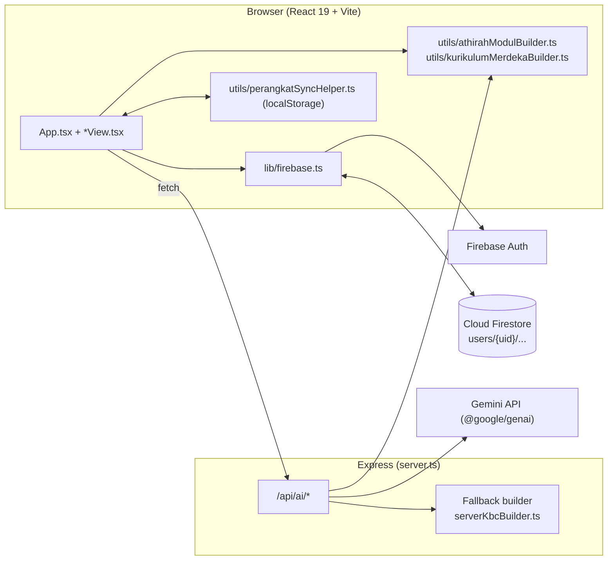
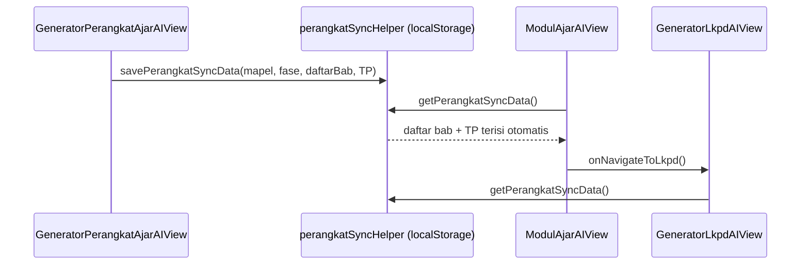

# Arsitektur Sistem — EduFutura AI

## 1. Gambaran Umum



- **Frontend** menangani UI, perhitungan nilai, dan akses Firestore langsung (SDK Firebase).
- **Backend Express** hanya untuk hal yang butuh rahasia server: memanggil Gemini, login server-side, dan menyajikan SPA.
- **Firestore** menyimpan seluruh data guru di bawah `users/{uid}`.

## 2. Struktur Folder

```
APLIKASIKU/
├── AGENTS.md                 # aturan untuk AI agent
├── docs/                     # dokumentasi pengembangan
├── graphify-out/             # knowledge graph kode
├── index.html                # entry HTML, font Google
├── server.ts                 # Express app + endpoint AI (createApiApp)
├── serverKbcBuilder.ts       # fallback dokumen KBC & ISO 015 sisi server
├── firestore.rules           # aturan keamanan Firestore
├── firebase-applet-config.json / firebase-blueprint.json
├── vercel.json / render.yaml # konfigurasi deploy
├── api/index.js              # bundle serverless (hasil build)
├── dist/                     # bundle frontend + server.cjs (hasil build)
├── public/                   # aset statis
└── src/
    ├── main.tsx / App.tsx    # bootstrap & shell aplikasi
    ├── api-serverless.ts     # entry Vercel (memanggil createApiApp)
    ├── types.ts              # tipe domain
    ├── index.css             # Tailwind 4 + token + CSS cetak dokumen
    ├── lib/firebase.ts       # Firebase & helper data
    ├── lib/swal.ts           # notifikasi SweetAlert2 seragam
    ├── components/           # satu file per halaman + komponen 3D
    └── utils/                # builder dokumen & helper sinkronisasi
```

## 3. Lapisan Frontend

### 3.1 Shell & Routing
`App.tsx` memegang state `activeTab` (bukan React Router). Setiap halaman dimuat malas dengan `React.lazy` + `Suspense` (`ViewLoadingSkeleton`). Navigasi desktop lewat `Sidebar`, mobile lewat bottom bar + sheet kategori (`AKADEMIK_ITEMS`, `AI_TOOLS_ITEMS`, `LAPORAN_ITEMS`).

| `activeTab` | Komponen |
|---|---|
| `dashboard` | `DashboardView` (+ `AnalisisPerkembanganSiswa`, `RankingSiswaDashboard`) |
| `siswa`, `kartu`, `mapel`, `jadwal` | `KelolaSiswaView`, `CetakKartuQRView`, `KelolaMapelView`, `JadwalMengajarView` |
| `absensi` | `InputAbsensiView` |
| `penilaian`, `nilai-tambah` | `InputPenilaianView` (sub-tab berbeda) |
| `raport` | `CetakRaportView` |
| `agenda`, `bimbingan` | `AgendaMengajarView`, `BimbinganWaliView` |
| `perangkat_ai`, `perangkat_kbc` | `GeneratorPerangkatAjarAIView`, `PerangkatAjarKBCView` |
| `modulai`, `lkpdai` | `ModulAjarAIView`, `GeneratorLkpdAIView` |
| `asistenai`, `ailainnya` | `AsistenGuruAIView`, `GeneratorAILainnyaView` |
| `laporan`, `pengaturan`, `resetdb`, `superadmin` | `PusatLaporanView`, `PengaturanView`, `ResetDatabaseView`, `SuperadminView` |

### 3.2 State & Data Flow
1. `subscribeAuthUser` → `currentUser` → `setActiveUserId(uid)`.
2. `App.tsx` berlangganan real-time ke semua koleksi (`subscribeCollection`) dan `subscribePengaturan`.
3. List (`siswaList`, `mapelList`, `nilaiList`, …) diteruskan sebagai props ke halaman.
4. Halaman menulis lewat `saveDocument` / `batchSaveDocuments` / `batchDeleteDocuments`; snapshot Firestore memperbarui UI otomatis.
5. Superadmin dapat "menginspeksi" guru lain (`inspectedTeacher`) sehingga subscription berpindah ke `uid` guru tersebut.

### 3.3 Rantai Data Perangkat Ajar



### 3.4 Pembuatan Dokumen
- **Deterministik (tanpa AI)**: `buildCompleteModulAjarHtml` → `buildExactAthirahModulHtml` (Format 1), `buildExactAthirahFormat2Html` (Format 2), `buildPerMeetingLkpdHtml` (LKPD), `buildAthirahIsoKopTable` (kop).
- **Dengan AI**: frontend memanggil `/api/ai/*`, server menyusun prompt dan memanggil Gemini; bila gagal, server memakai fallback builder.
- **Ekspor**: cetak via `window.print()` dengan CSS `@page`, unduh Word via HTML MSO blob (`.doc`), PDF via `jspdf` + `jspdf-autotable`, Excel via `xlsx`, PPT via `pptxgenjs`.

## 4. Lapisan Backend (`server.ts`)

- `createApiApp()` membuat Express app yang dipakai bersama oleh dev server, Render (`dist/server.cjs`), dan Vercel (`api/index.js`).
- `getAiClient()` membuat `GoogleGenAI` dari `GEMINI_API_KEY`, dipanggil **hanya** di cabang yang benar-benar butuh AI.
- `generateContentWithRetry()` mencoba berurutan: `gemini-3.8-flash` → `gemini-3.5-flash-lite` → `gemini-2.5-flash` → `gemini-2.0-flash` → `gemini-1.5-flash`, masing-masing 2 percobaan; error autentikasi langsung dilempar.
- Mode dev: Vite berjalan sebagai middleware; mode produksi: menyajikan `dist/` dan fallback `index.html`.

Detail endpoint: [API.md](API.md).

## 5. Keputusan Arsitektur (ADR Ringkas)

| # | Keputusan | Alasan | Konsekuensi |
|---|---|---|---|
| 1 | Firestore diakses langsung dari klien | Real-time, sederhana, gratis tier | Keamanan bergantung pada `firestore.rules` |
| 2 | Data per guru di `users/{uid}/…` | Isolasi tanpa query filter | Superadmin butuh akses lintas `uid` |
| 3 | Routing berbasis state, bukan URL | Kompatibel dengan iframe AI Studio | Tidak ada deep link |
| 4 | Template sekolah dibangun deterministik | Format harus presisi & tidak tergantung AI | Perubahan template = ubah kode builder |
| 5 | Dokumen dihasilkan sebagai HTML | Mudah pratinjau, cetak, dan unduh Word | Bukan `.docx` asli; tampilan Word bisa sedikit beda |
| 6 | Sinkronisasi perangkat ajar via localStorage | Cepat, tanpa skema baru | Tidak ikut pindah perangkat/browser |

## 6. Titik Perluasan

- Tambah halaman: buat `src/components/NamaView.tsx`, daftarkan `lazy()` di `App.tsx`, tambahkan item ke `Sidebar`/kategori mobile.
- Tambah koleksi: tambahkan ke `COLLECTIONS`, tipe di `types.ts`, subscription di `App.tsx`, daftar di `syncAllLocalDataToFirestore` & `clearAllDatabaseCollections`, dan aturan di `firestore.rules`.
- Tambah template modul: tambahkan nilai `formatOutput` di `ModulFormState`, cabang di `buildCompleteModulAjarHtml`, dan kartu pilihan di `ModulAjarAIView`.

