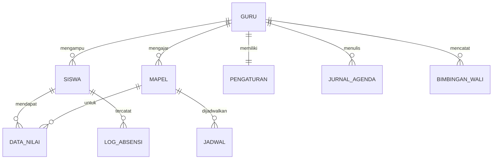

# Model Data — EduFutura AI

Sumber kebenaran tipe: [`src/types.ts`](../src/types.ts). Nama koleksi: `COLLECTIONS` di [`src/lib/firebase.ts`](../src/lib/firebase.ts).

## 1. Struktur Firestore

```
users/{uid}                      ← profil guru (GuruUser)
  ├── data_siswa/{id}            ← Siswa
  ├── mapel/{id}                 ← Mapel
  ├── jadwal/{id}                ← Jadwal
  ├── log_absensi/{id}           ← LogAbsensi
  ├── data_nilai/{id}            ← DataNilai
  ├── jurnal_agenda/{id}         ← JurnalAgenda
  ├── siswa_bimbingan/{id}       ← SiswaBimbingan
  ├── bimbingan_wali/{id}        ← BimbinganWali
  └── pengaturan/config          ← Pengaturan (satu dokumen)
```

> Akses selalu lewat helper (`getFirestoreColRef`, `saveDocument`, dst.) yang otomatis menambahkan prefix `users/{uid}`. Untuk mode remix/tamu, helper menyimpan ke `localStorage` dengan kunci `getScopedStorageKey(koleksi, uid)`.



## 2. Entitas

| Koleksi | Tipe | Field penting |
|---|---|---|
| `data_siswa` | `Siswa` | `nisn`, `nama`, `kelas` |
| `mapel` | `Mapel` | `namaMapel`, `semester`, `tahunAjaran` |
| `jadwal` | `Jadwal` | `hari`, `jam`, `kelas`, `mapel` |
| `log_absensi` | `LogAbsensi` | `tanggal`, `kelas`, `mapel`, `idSiswa`, `status` (`Hadir`/`Izin`/`Sakit`/`Alpa`) |
| `data_nilai` | `DataNilai` | `jenis`, `mapel`, `kelas`, `idSiswa`, `nilai` (`number` atau `""`) |
| `jurnal_agenda` | `JurnalAgenda` | `tanggal`, `jam`, `kelas`, `materi`, `status` |
| `siswa_bimbingan` | `SiswaBimbingan` | `namaSiswa`, `kelas` |
| `bimbingan_wali` | `BimbinganWali` | `jenis`, `kasus`, `tindakLanjut` |
| `pengaturan/config` | `Pengaturan` | identitas guru, sekolah, kepala sekolah, logo kop |
| `users/{uid}` | `GuruUser` | `email`, `displayName`, `nip`, `sekolah`, `role` (`guru`/`superadmin`) |

Semua entitas memiliki `id: string` dan opsional `updatedAt: number` (epoch ms).

> **Catatan**: kelas tidak memiliki koleksi sendiri. Daftar kelas = nilai unik `Siswa.kelas`.

## 3. Aturan Penilaian

### 3.1 Klasifikasi `DataNilai.jenis`
Fungsi `categorizeJenisPenilaian(jenis)` di `InputPenilaianView.tsx`:

| Kategori | Dikenali bila `jenis` (huruf kecil) … |
|---|---|
| `nilai_tambah` | mengandung `nilai tambah`, `nilai_tambah`, `poin`, `keaktifan`, `bonus`, `public speaking`, `tambahan` |
| `uts` | sama dengan `uts`/`sts` atau mengandung `tengah semester` |
| `uas` | sama dengan `uas`/`sas` atau mengandung `akhir semester` |
| `sumatif` | selain di atas (mis. `Sumatif Materi 1`, `Sumatif 2`) |

Konvensi penamaan `jenis`:
- Sumatif: `Sumatif Materi {n}` atau `Sumatif Materi - {judul}`
- Nilai Tambah per kategori: `Nilai Tambah - Public Speaking`, `Nilai Tambah - Keaktifan`, `Nilai Tambah - Tugas Tambahan`
- Nilai Tambah langsung dari Master Input: `Nilai Tambah`

### 3.2 Rumus (`hitungNilaiAkhirSiswa`)

$$
\text{Nilai Murni} = 0.50\,\overline{S} + 0.35\,\text{UTS} + 0.15\,\text{UAS}
$$

$$
\text{Nilai Akhir} = \min(100,\ \text{Nilai Murni} + \textstyle\sum \text{Nilai Tambah})
$$

- Komponen kosong dihitung 0. Pembulatan 1 desimal.
- Predikat: A ≥ 88 (Sangat Baik), B ≥ 78 (Baik), C ≥ 70 (Cukup), D < 70 (Perlu Bimbingan).

### 3.3 Invarian yang wajib dijaga
1. Rata-rata/grafik nilai ujian **mengecualikan** kategori `nilai_tambah`.
2. Menyimpan Master Input tidak boleh menyalin ulang poin `Nilai Tambah - {kategori}` ke dokumen `Nilai Tambah`.
3. Nilai yang dikosongkan/di-reset → dokumen dihapus (`batchDeleteDocuments`).

## 4. Data Lokal (localStorage)

| Kunci | Isi |
|---|---|
| `edadmin_active_uid` | `uid` guru aktif |
| `edadmin_theme` | `dark` / `light` |
| `guru_welcome_guide_seen` | panduan sudah dilihat |
| Kunci sinkronisasi perangkat ajar (`perangkatSyncHelper.ts`) | `PerangkatAjarSyncData`: mapel, fase, daftar bab, TP |
| Kunci scoped per koleksi | data mode tamu/remix |

